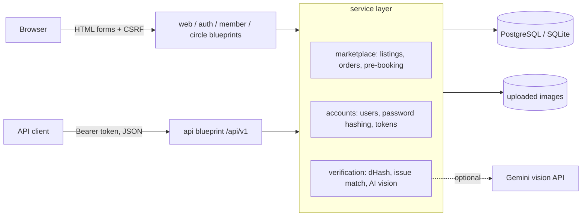

# National Philatelic Community

A marketplace and community platform for stamp collectors (philatelists) and India's postal
circles, built with Flask, SQLAlchemy and PostgreSQL. Every listing is automatically checked:
photos are compared against other sellers' listings and the postal circle's official reference
image.

- **Philatelists** buy and sell stamps in the Stamp Mela, keep a wishlist, pre-book new official
  issues in the Stamp Store and track everything in My Collection.
- **Postal circles** publish official issues (with a reference image and pre-booking stock), set
  stock, post news updates and run events such as stamp melas.
- **Home page** shows upcoming releases, events and news from the circles *and* imported from
  India Post and Rainbow Stamp News, plus a help chatbot (Gemini when configured).
- **NPDA accounts** (modelled on India Post's Philatelic Deposit Account): open one in a click from
  your profile, keep a balance, and every new issue from your chosen circles is reserved and paid
  for automatically when it is published.
- **Community**: forums, public collector profiles with their collection, computed badges and
  follows, notifications, and a crash course with progress tracking.
- **Sign in with Google or Yahoo** (OpenID Connect) alongside username and password.
- **Listing verification** flags copied photos and claims that don't match the official issue.
- **REST API** (`/api/v1`) with bearer tokens, pagination, filters and consistent JSON errors.

## Feature notes

**NPDA standing orders.** `services/npda.py::fulfil_new_issue` runs when a circle publishes an
issue. Subscribers are served oldest account first. Stock and balance are each taken with a
conditional `UPDATE ... WHERE stock >= n` / `WHERE balance >= cost`, and stock is put back if the
balance is short, so concurrent bookings can't oversell or overdraw. Each subscriber is
notified of the outcome. India Post has no public API for opening a real PDA, so this is the
app's own account, and deposits are simulated.

**Imported headlines** (`flask import-feeds`, run it from cron, e.g. every 6 hours):

| Source | How | Goes to |
|---|---|---|
| postagestamps.gov.in/News.aspx | HTML parsing (no API/RSS exists; robots.txt allows it) | Releases (title, ₹ value, number of stamps, date) and notices |
| Rainbow Stamp News | RSS | News |
| Anything in `FEED_EXTRA_RSS` | RSS/Atom | releases, news or events |

Only headline facts are stored, each with a link to the original. The importer sends one
request per source, honours robots.txt, uses timeouts, and skips a failing source without
affecting the others. indiapost.gov.in (Stamp Calendar) blocks automated clients, so it is
deliberately not used. Parsers are tested offline against saved copies of the real pages.

**Badges** are computed from data every time (no manual awards): First Stamp, Collector (10),
Curator (50), Circle Explorer (3 circles), Vintage Hunter (pre-1950), Trusted Seller, Standing
Order (NPDA), Scholar (crash course), Community Voice (5 posts), Well Known (5 followers).
Collectors can hide their collection from their public profile.

**SSO.** A known Google/Yahoo identity signs into its linked account. Otherwise a *verified*
email is linked to the matching account, or a new philatelist account is created. Postal circle
(official) accounts can't use SSO.

## Architecture



The web UI and the API are thin layers over one service layer, so validation and business rules
live in one place and are tested once.

```
app/
  __init__.py        app factory, error handlers
  config.py          config from environment variables (no secrets in code)
  models.py          SQLAlchemy 2.0 models with DB-level check constraints
  auth.py            login / register (philatelist and postal circle forms), Google/Yahoo SSO
  web.py             home, Stamp Store, Stamp Mela marketplace, selling, buying, wishlist
  member.py          philatelist dashboard, profile, NPDA, My Collection, notifications, settings
  community.py       forums, collector profiles + follows, crash course progress
  circle.py          postal circle dashboard, Manage Stamps, events, settings
  api.py             JSON REST API
  services/          business logic: marketplace, accounts, npda, sso, feeds, collectors,
                     notifications, uploads, chatbot, domain errors
  templates/ static/ the original v1 pages and styles, wired to the new backend
  verification/      imagehash (dHash from scratch), vision client, check runner
  cli.py             `flask seed` demo data
migrations/          Alembic migrations (Flask-Migrate)
tests/               pytest suite: unit, service and HTTP-level tests
```

## Listing verification

Each listing gets a report with three checks, re-run whenever the seller edits their claims.

| Check | How it works | Result |
|---|---|---|
| `duplicate_photo` | 64-bit perceptual **dHash** of the photo's central design, compared by Hamming distance with every other seller's listing. Survives resizing, recompression and brightness changes. | fail if distance ≤ 6 |
| `official_issue` | If the listing claims an official issue, the photo is compared with the circle's reference image and the year with the issue date. | pass ≤ 10, warn ≤ 18, else fail |
| `ai_vision` | *Optional.* Gemini reads the country, year and denomination from the photo, and the result is compared with the listing. Skipped if no API key is set or the API is down. | warn on year mismatch, fail if not a stamp |

**Why the hash ignores the border.** Every stamp has a perforated white edge and a frame. At 9×8
pixels those shared features dominate, and in testing two *different* stamps came out only 3 bits
apart. Cropping 12% from each side before hashing raised the closest different pair to 13 bits,
while resized, recompressed and brightened copies still scored 0. The measurement is documented in
`app/verification/imagehash.py`.

Overall status: any **fail** means *flagged*, any **warn** means *needs review*, and at least one
**pass** means *verified*.

These checks catch copied photos and inconsistent claims. They **do not** certify that a physical
stamp is genuine, which needs an expert examination.

The duplicate search is a linear scan, which is fine at this size. With a large catalogue, a
BK-tree or multi-index hashing would find near neighbours without comparing every row.

## Correctness details worth knowing

- **No overselling.** Stock is taken with one conditional `UPDATE ... SET quantity = quantity - :n
  WHERE quantity >= :n`. If two buyers race for the last copy, the database serialises the updates
  and the second one matches zero rows. Pre-booking works the same way.
- **Passwords** are hashed with Werkzeug (scrypt). Usernames and emails are unique, ignoring case.
- **API tokens** are signed with `itsdangerous` and expire after 7 days. Each token embeds part of
  the password hash, so changing a password revokes old tokens.
- **Uploads** are decoded with Pillow, not trusted by extension, re-saved under a random name and
  capped at 5 MB.
- **CSRF** protection on every HTML form. `?next=` redirects only allow local paths.
- **Removing a listing is a soft delete**, so past orders keep their history.

## Running it

### Docker (Postgres + gunicorn)

```bash
cp .env.example .env        # set SECRET_KEY
docker compose up --build
docker compose exec web flask seed   # optional demo data
```

Open http://localhost:8000 for the login page, or http://localhost:8000/home for the community
home page.

### Local (SQLite)

```bash
uv sync
cp .env.example .env        # set SECRET_KEY
uv run flask --app wsgi db upgrade
uv run flask --app wsgi seed
uv run flask --app wsgi import-feeds   # optional: fetch India Post / RSS headlines
uv run flask --app wsgi run --debug
```

The seed creates the philatelists `alice` and `bob` and the postal circle `ap_circle` (log in with
the Postal Circle tab and pick "Andhra Pradesh"), all with the password `demo-password`. It also
creates listings that show each verification outcome: verified, a mismatched official issue, and
a copied photo.

### Tests and lint

```bash
uv run pytest --cov=app
uv run ruff check .
```

CI (GitHub Actions) runs lint and tests, applies the migrations to a real Postgres, seeds it, and
builds the Docker image.

## API quick reference

```bash
# get a token
curl -X POST localhost:8000/api/v1/auth/token -H 'Content-Type: application/json' \
     -d '{"username":"alice","password":"demo-password"}'

# browse (public)
curl 'localhost:8000/api/v1/listings?q=temple&verified=1&per_page=10'

# create a listing (multipart, because it has an image)
curl -X POST localhost:8000/api/v1/listings -H "Authorization: Bearer $TOKEN" \
     -F title='Tiger 1983' -F year=1983 -F price=15 -F quantity=2 -F image=@tiger.jpg

# buy
curl -X POST localhost:8000/api/v1/orders -H "Authorization: Bearer $TOKEN" \
     -H 'Content-Type: application/json' \
     -d '{"listing_id": 4, "quantity": 1, "shipping_address": "Pune"}'
```

| Method | Path | Auth |
|---|---|---|
| POST | `/api/v1/auth/token` | none |
| GET | `/api/v1/me` | token |
| GET | `/api/v1/listings` (`q`, `year`, `min_price`, `max_price`, `verified`, `page`, `per_page`) | none |
| GET | `/api/v1/listings/<id>` | none |
| POST | `/api/v1/listings` | token |
| PATCH / DELETE | `/api/v1/listings/<id>` | token (owner) |
| GET / POST | `/api/v1/listings/<id>/verification` | none / token (owner) |
| GET / POST | `/api/v1/orders` | token |
| GET | `/api/v1/issues` | none |
| POST | `/api/v1/issues/<id>/prebook` | token (collector) |
| GET | `/api/v1/events` (`upcoming=1`) | none |

Errors always look like `{"error": {"code": "out_of_stock", "message": "..."}}`.

## History

Version 1 (2024) was a college project: a Flask prototype with hard-coded database credentials,
plaintext passwords and two separate apps merged together. Many of its forms were front-end only
(alerts or localStorage), and some pages crashed.

Version 2 keeps the v1 pages and styles and replaces everything behind them. Every form now saves
to the database: posting circle updates, stock, issues, events, profiles, settings, purchases,
pre-bookings and the wishlist. The search page, the Filter menu and the ❤️ button now work.
Verification badges and reports are styled to match the existing pages.
